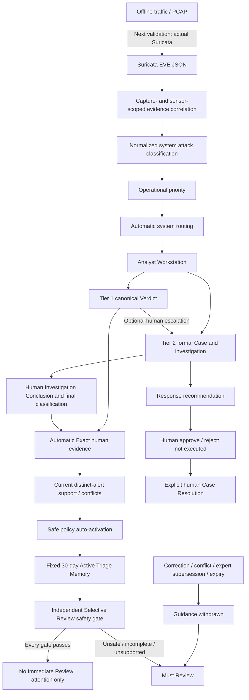

# Final Golden Path End-to-End Product Validation

Base: `feat/safe-memory-auto-activation`, `9ec9d4c7d453c4273cd87cf330871b0627a1e568`.
Validation branch: `feat/final-golden-path-e2e`.

This is product validation, not a feature increment. No production code, policy, threshold, role model, migration or existing test assertion was changed. New files provide one coherent real-frontend/real-backend Golden Path, its disposable fixture, a dedicated Playwright configuration and durable validation evidence.

## Tested architecture and boundary



The executed boundary begins with representative **synthetic Suricata-format EVE records**, not a claim that actual Suricata was run on a real PCAP. All records pass the current importer, correlation, admission, classification and routing implementation. Each normal source includes two distinct signatures plus flow and SSH supporting records. Original sensor, capture scope, flow identity and all records are retained. No ground-truth, fabricated XGBoost output or TreeSHAP is supplied; Suricata confidence remains null / Not provided.

The fixture stages raw prerequisites only. Initially it contains **zero operational alerts, Cases, Verdicts, Memory lessons or collection runs**. Operational admission, Verdicts, corrections, Narrow expansion, escalation, investigation, response approval, resolution and review decisions use existing product UI/actions. Future D is admitted only after A/B/C activate the lesson.

Test-only `/__golden` helpers are mounted solely by the disposable fixture, never by production startup. They provide a manifest, deterministic clock, explicitly synthetic trusted-context prerequisites and a read-only database fingerprint/current-vote proof. They cannot manufacture canonical judgments, route transitions, Cases, Memory activation, response decisions or resolution. Time changes do not edit historical rows. The database is removed after the run.

## Coherent operational stories

| Golden Path | Validation and invariant |
| --- | --- |
| A: Routine Tier 1 | Incoming Alerts UI accepts and admits correlated EVE. System classifies brute force and routes Tier 1. Expected Activity Verdict is authored by the signed-in analyst; automatic Exact evidence is System Policy. Original classification and routing remain identical. |
| B: Automatic learning | Distinct A/B/C produce support 1 → 2 → 3. First two remain Candidate; third automatically activates. No manual Exact contribution or Activate action occurs. |
| C: Future review reduction | D is admitted after activation, receives fresh safe context and passes Evaluate Review Policy. KPI, filtered queue, detail, context rail and Selective Review agree on No Immediate Review. D still has no human Verdict. |
| D: Canonical recall / R01/R02 | D receives Confirmed Malicious via the Verdict UI. Review is immediately recalled; KPI drops to zero deferred alerts and detail/rail require review. `canonicalVerdict` is present and the later contradictory-outcome metric becomes 1. |
| E: Conflict withdrawal | D is distinct from A/B/C. Its authoritative contradiction changes the lesson to Conflict Review before expiry while preserving historical activation. Newly admitted E must review. |
| F: Correction | A revision 2 replaces its earlier Expected Activity with Confirmed Malicious. Revision 1 remains historical; effective support becomes 2 and conflicts 2. Retrying the canonical command and explicit Narrow expansion do not add a second vote from A. |
| G: Unknown auto Tier 2 | Opaque attack-like U remains Unknown / Needs Expert. Automatic system routing creates a formal Case without a Tier 1 Verdict, human routing approval, fake creator or owner. Intake eligibility approval is separate from routing approval. |
| H: Investigation | The analyst opens Investigation Brief, related-alert suggestions and suggested steps; starts investigation and records Confirmed Malicious / Web Attack. System classification stays Unknown. |
| I: Expert automatic learning | The conclusion automatically creates Exact expert evidence; author and final attack category remain provenance. Outcome is Confirmed Malicious and is not auto-activated. |
| J: Inconclusive and expert authority | I1/I2/I3 create a separate three-support benign lesson. Inconclusive on I1 removes its current vote, creates no reusable expert evidence and drops support below threshold. A malicious expert conclusion on I2 replaces its Tier 1 evidence with exactly one expert vote. |
| K: Response | A real recommendation is generated for U. The human approves Block Source IP as a plan; status is Approved — Not Executed. |
| L: Resolution | U is explicitly resolved with a human reason, author and timestamp. Conclusion, classification, response, learning and timeline remain readable. API attempts to add notes, start investigation, link an alert, add a conclusion or recommend another response return 409. |
| M: Expiry | T1/T2/T3 automatically activate a separate benign lesson. Safe T5 can defer before expiry. Day-15 T4 support raises the count to 4 without changing expiry. At the exact expiry boundary, fresh safe T5 context cannot overcome expiry. New evidence after expiry preserves the same expired lesson and does not reactivate it. |

The aging story uses a separate native category as well as source context. The existing policy deliberately vetoes related unsafe/conflicted Memory, including partial matches returned for the same native category. An earlier fixture sharing that category correctly failed the assumption that its aging alert was otherwise safe. This was corrected in **test prerequisites**, not by weakening the product safety policy.

## Final policy facts

- Canonical Tier 1 Verdicts and eligible Tier 2 Investigation Conclusions automatically create **Exact** evidence. Normal Exact learning needs no second contribution click.
- Current authority is **latest Tier 2 > latest Tier 1 > historical compatibility evidence**. Inconclusive leaves zero reusable current votes from that alert.
- **One Alert = One Current Learning Vote**, even with revisions, retries/reloads and automatic Exact plus explicit Narrow contributions.
- Policy: **safe-memory-auto-activation-v1**, reusing unchanged **triage-memory-v1**.
- Eligible outcomes: **expected_activity / false_positive**; activation scope **Exact only**.
- Minimum support **3 independent alerts**; configured minimum agreement **0.67**; maximum conflicts **0**. With zero allowed conflicts, an eligible lesson has no contradictory current evidence.
- Activation is attributed to **system_policy**, with NULL human actor and versioned audit provenance. The real human judgment author is preserved separately.
- `validFrom` is activation time; `expiresAt = validFrom + 30 days`. At `now >= expiresAt`, `guidanceActive=false` and that lesson cannot reduce review.
- No mathematical decay, sliding renewal or automatic post-expiry reactivation. New support on day 15 does not move the original day-30 boundary. Historical evidence/activation remain readable.
- Active Memory alone is insufficient. Fresh trusted context, correct Exact/high match, supported workflow, no canonical judgment, no human override, and no malicious/conflict/high-risk/campaign veto are still required. Existing deterministic audit sampling also remains unchanged.
- Review reduction uses the existing **Evaluate Review Policy** write action. GET inspection neither grants nor persists automatic deferral. No Immediate Review is attention only, not benign classification, a Verdict, approval or closure.

## Attribution, authorization and inspection

Human actions retain the authenticated actor: Verdict, manual escalation, expert conclusion/final classification, Narrow expansion, response approval and resolution. System actions retain System Policy attribution without a fake human: routing, automatic Case creation, Exact contribution and activation.

The coherent browser scenario also checks evaluator read access and 403 responses for Verdict, Narrow contribution, Case notes, response approval and resolution. A database digest is unchanged by those rejected requests. Full backend regressions cover the existing operational-role allowlists and inactive/unauthenticated identities.

GET safety is checked by comparing a complete read-only SQLite dump digest before/after queue, metrics, Memory, matches, Case, response and history inspection. Expiry is derived without writing. Final foreign-key checks remain clean and the disposable Golden Path records zero prospective collection runs.

There is no response execution endpoint/dispatcher in the approval path. The response implementation records plans and human decisions only. The tested browser sends no execution request, and the resolved response snapshot explicitly records `not_executed`. No firewall, host isolation, account disable or external response was performed.

Queue ordering remains operational priority descending, occurred-at descending and deterministic alert reference; dedicated backend regression covers null/unassigned priority last and timestamp edge cases. Native severity, operational priority, confidence, classification, human outcome and routing remain separate concepts. No Golden Path needs Legacy Workstation or historical ML pages.

## Missing-data tests: bounded investigation

These five optional historical/external-data tests do not provide a runtime dependency of the current Suricata Golden Path:

| Test | Missing artifact / purpose |
| --- | --- |
| `test_contracts.py::test_real_ml_predictions_fit_the_contract_and_persist` | `demo_ml_predictions_shap.json`: historical real XGBoost/SHAP output contract |
| `test_fusion.py::test_demo_flows_fuse_as_changelog_v1_3_reports` | Demo flow CSV and ML prediction output: historical fusion figures |
| `test_observable.py::test_frame_projection_reproduces_the_tuned_on_view` | `demo_detection_input.csv`: historical tuned dataframe reproduction |
| `test_rule_set.py::test_held_out_sample_reproduces_handover_figures` | Gitignored 136 MB `train_sample.csv`: external held-out dataset figures |
| `test_run.py::test_the_demo_sample_runs_end_to_end` | Historical demo sample/predictions: legacy CSV/XGBoost detection replay |

No missing dataset was fabricated or downloaded. Current Suricata import/correlation and the full Golden Path run without those files. Their historical claims remain unverified in this workspace and are a non-blocking limitation.

## Findings and scope control

- **BLOCKER:** none found in validated scope.
- **MAJOR:** none found in validated scope; no product fix required.
- **MINOR:** existing Verdict Learning links use the analyst prefix for non-analyst readers. This is a non-critical navigation issue; role-specific Memory navigation and server authorization remain available. It is recorded, not changed.
- **BACKLOG / FUTURE:** actual offline PCAP → installed Suricata → generated `eve.json` validation; optional historical datasets; potential review of broad related-category conservative veto behavior. Live streaming, ML feature bridge/retraining, renewal/decay, SOAR execution, reopen, assignment, SLA and UI redesign are not part of this validation.

The broad-category veto is intentional conservative policy, not classified as a defect. Build chunk-size and existing test-library warnings do not block the product flow. Test-development corrections (existing route names, separate override reason, fixture category isolation) did not change production behavior or weaken assertions.

## Assessor-ready explanation

“The current product correlates offline Suricata evidence, preserves its provenance, classifies the attack and assigns operational priority and routing. Analysts record canonical Tier 1 Verdicts or Tier 2 Investigation Conclusions; those judgments automatically become Exact Memory evidence with one current vote per alert and Tier 2 authority over Tier 1. The system only auto-activates Expected Activity or False Positive lessons after three independent supporting alerts satisfy the 0.67 agreement threshold with zero conflicts. Activation is System Policy, while the human remains the judgment author. Memory is valid for a fixed 30 days without decay, renewal or automatic reactivation. Every future alert still passes Selective Review safety checks; conflicts, supersession, corrections and expiry withdraw unsafe guidance. Response approval records a human-approved plan without execution, and Case resolution is an explicit auditable human action.”

## Reproduction

From `apps/web`, use the project's installed Python environment through `HITL_PYTHON`, then run:

```text
node node_modules/@playwright/test/cli.js test --config=playwright.final-golden-path.config.ts
```

The fixture binds API port 8030 and frontend port 5200, refuses to reuse existing servers, and creates/removes its own temporary database. The run produces a detailed `golden-path-evidence.json` and screenshots under ignored `apps/web/test-results/final-golden-path/`. A compact, credential-free evidence extract is retained with this document.

Protocol V2 is historical, frozen and unopened. Its pinned artifact hash remains `cfc9539c0b325919a60eb8a5722826affa53e1c253e3b96c15e3a6db41dd2541`; `collectionOpened=false`. This validation branch is not represented as the historical protocol's pinned runtime SHA. No merge, PR, real/demo data mutation or prospective collection is performed.

## Final executed results

| Validation | Result |
| --- | --- |
| Entire backend repository suite | **1,511 passed, 5 skipped, 0 failed**, one complete run (709.65 seconds) |
| Frontend | **254 passed, 35 files**, 0 failed |
| Coherent Golden Path browser E2E | **1 passed**, 47.3 seconds for the complete scenario; 58.6 seconds including servers |
| TypeScript | Passed |
| OpenAPI and generated client freshness | Passed |
| Production build | Passed; pre-existing large-chunk warning |
| Responsive/theme | 30 screenshots: five core controls × 1440/1024/390 × Light/Dark; visibility, enabled state and page overflow assertions passed; representative desktop/tablet/mobile images visually inspected |
| Protocol V2 | Freeze regression and artifact hash validation passed; unopened |
| Database integrity | Zero foreign-key violations; GET digest unchanged; rejected evaluator writes leave digest unchanged |

Durable, credential-free results: [`evidence/final-golden-path-e2e.json`](evidence/final-golden-path-e2e.json). It records 14 admitted alert references, source flow/capture identities, classification/priority/route, judgment revisions/authors, manual escalation attribution, Memory snapshots, current votes, terminal Case/response state, evaluator denials and queue ordering. Historical snapshots are labelled by story phase rather than represented as simultaneous final state.

Representative observed identities:

- Auto-active lesson: `db41e848-f5e5-4c3e-aaa2-4d3033fb5a42`; support 3, conflicts 0, agreement 1.0; System Policy actor NULL.
- Activation: `2026-11-01T22:08:42.376371Z`; fixed expiry: `2026-12-01T22:08:42.376371Z`.
- Unknown → malicious/Web Attack → approved-not-executed → resolved Case: `28d04771-e327-55d5-a7a9-dd19bef72e27`, terminal revision **4**.
- Later contradictory-outcome metric: **1**.
- Independent aging lesson expiry: `2026-12-01T22:09:07.572333Z`; unchanged by day-15 support and post-expiry evidence.

The deterministic clock intentionally affects domain time. Evaluator authentication checks run before advancing it so newly minted authentication tokens are not future-dated relative to the JWT library's real clock. This is harness scheduling, not a product/authentication change.

## Core product completion table

Status describes the current offline EVE product scope, with actual PCAP/Suricata execution explicitly separated below.

| Product component | Status |
| --- | --- |
| Suricata intake/correlation | COMPLETE |
| Attack Classification | COMPLETE |
| Operational Priority | COMPLETE |
| Automated Routing | COMPLETE |
| Analyst Workstation | COMPLETE |
| Tier 1 Verdict | COMPLETE |
| R01/R02 Verdict safety | COMPLETE |
| Automatic Tier 1 Learning | COMPLETE |
| Triage Memory | COMPLETE |
| Auto-Activation | COMPLETE |
| Aging / Expiry | COMPLETE |
| Selective Review | COMPLETE |
| Tier 2 Case | COMPLETE |
| Investigation Assistance | COMPLETE |
| Human Reclassification | COMPLETE |
| Automatic Tier 2 Learning | COMPLETE |
| Response Recommendation | COMPLETE |
| Human Response Decision | COMPLETE |
| Case Resolution | COMPLETE |

## Decision and next step

**PASS WITH NON-BLOCKING LIMITATIONS**

The product is ready to proceed to **real offline PCAP → actual Suricata → real eve.json → current importer → Analyst Workstation** validation. That external detector run has not been claimed as completed here. Five optional historical data tests and the non-critical role-prefix navigation issue remain documented. There are no outstanding BLOCKER/MAJOR findings in the tested scope.

Only these five files are added:

1. `apps/web/e2e/final-golden-path-fixture.py`
2. `apps/web/e2e/final-golden-path.spec.ts`
3. `apps/web/playwright.final-golden-path.config.ts`
4. `docs/evidence/final-golden-path-e2e.json`
5. `docs/final-golden-path-e2e.md`
