# Real offline PCAP → Suricata → Analyst Workstation validation

**Decision: PASS WITH NON-BLOCKING LIMITATIONS**

Base: `feat/final-golden-path-e2e` at `c6dc8a4a177ac2e4bec07f80308d005fccb9273c`.
Validation branch: `feat/real-suricata-pcap-validation`.
Executed on 2026-11-02. No production code, policy, classification mapping, routing exception, schema or existing test was changed.

## Goal and boundary

The previous Golden Path used **synthetic EVE** to prove deterministic software workflow behavior. This validation uses **actual Suricata 8.0.7 executing offline on external PCAPs**, with the unedited resulting `eve.json` passed to the existing importer and product. It proves detector integration, not detection accuracy, classifier accuracy, workload reduction, production readiness or a final quantitative experiment.

```mermaid
flowchart LR
  P[Traceable public PCAP] --> S[Actual Suricata -r / ET Open]
  S --> E[Unmodified eve.json]
  E --> I[Existing stage_file importer]
  I --> C[Sensor + capture + flow correlation]
  C --> A[Existing eligibility and admission commands]
  A --> N[Existing classification / priority / routing]
  N --> W[Real Analyst Workstation]
  W --> T[Automatic Tier 2 Case]
  T --> H[Human starts investigation]
```



All data is isolated in `.validation/real-validation.db` in this worktree. It started with zero operational alerts, Cases, Verdicts, Memory or collection runs. Public source descriptions remain external documentation; only actual EVE enters operational evidence. No packet replay onto a network, live capture, payload extraction/execution, malware execution, response execution or prospective collection occurred.

## Actual detector environment and rules

| Item | Executed configuration |
| --- | --- |
| Engine | **Suricata 8.0.7 RELEASE**, official Windows x64 MSI |
| OS | Windows 11, build `10.0.26200`, x64 native execution |
| Local engine | `.validation/suricata/PFiles/Suricata/suricata.exe` |
| PCAP dependency | Official Npcap **1.90** x64 `wpcap.dll` and `Packet.dll`, extracted next to the engine; no driver installation/service |
| Build | GCC 16.1.0, Rust 1.96.1, LibHTP 8.0.7, PCRE JIT, Npcap/TLS/Rust enabled; libmagic/Hyperscan unavailable |
| Config | `.validation/suricata.yaml`, based on the official MSI's shipped YAML |
| Changes | Only three local paths: `default-rule-path`, `classification-file`, `reference-config-file`; rules selected with `-S` |
| Network definitions | Shipped RFC1918 HOME_NET and `!$HOME_NET` EXTERNAL_NET unchanged across all captures |
| EVE | Shipped alert, flow, HTTP, DNS, TLS, SSH, files/fileinfo and anomaly outputs retained; file-store disabled |
| Rules | [Emerging Threats Open official Suricata 8 archive](https://rules.emergingthreats.net/open/suricata-8.0/emerging.rules.tar.gz); direct archive workflow, not an installed suricata-update CLI |
| Rules snapshot | Retrieved `2026-11-02T05:39:47Z`; latest archive member timestamp `2026-10-30T20:47:00Z` |
| Rule count | **52,794 loaded, 0 failed** in the successful runs |
| Capability exclusion | Exactly **9** active `file.magic` rules disabled because this official Windows build lacks libmagic; no sample-specific rule edits |

The initial unmodified archive configuration test failed on unsupported `file.magic`. Disabled SIDs: `2065690`, `2064945`, `2064946`, `2064947`, `2064948`, `2064949`, `2064950`, `2064951`, `2064952`. All other archive rules retain their original active/disabled state. No custom rule, enable-all transformation or forced-alert rule was added.

Successful configuration test exit: **0**. Successful offline processing exit: **0** for all three captures. Native warnings are documented: no local `threshold.config` (no custom threshold overrides applied), stack size automatically set to 512k, and Windows `setrlimit` unavailable. No ignored rule-load failure remains.

Official package references: [Suricata downloads](https://suricata.io/download/), [exact MSI](https://www.openinfosecfoundation.org/download/windows/Suricata-8.0.7-1-64bit.msi), [Npcap](https://npcap.com/), [exact Npcap package](https://npcap.com/dist/npcap-1.90.exe). Full `--build-info`, config hash, rules hash and disabled SIDs are in the [machine-readable evidence](evidence/real-suricata-pcap-validation.json).

| Artifact | SHA-256 |
| --- | --- |
| Suricata MSI | `f0acc93179a4ffb05d450bb08153a94bd5aa46b0e56b3b3be496cabf0b4152b7` |
| ET Open archive | `d5330ebe76cb36cfad3621f2d9c66d0d5894d55a8778dba1f6c21c99a777b035` |
| Loaded compatible rules | `c083b161664b959a39c0b23935fcca4179a52a0fa2f01be92f681de064710e24` |
| Local configuration | `cf846c63a723f9ebacbb36d24431f11649794bb446c865ac51e7fe79e3736c55` |

## PCAP provenance and checksums

| Capture | Source / published context | Local file | Bytes | Packets |
| --- | --- | --- | ---: | ---: |
| Slammer | [Wireshark SampleCaptures](https://wiki.wireshark.org/SampleCaptures), published Slammer worm sample; [download](https://wiki.wireshark.org/uploads/__moin_import__/attachments/SampleCaptures/slammer.pcap) | `slammer.pcap` | 458 | 1 |
| HTTP | Same established Wireshark repository, simple HTTP request/response; [download](https://wiki.wireshark.org/uploads/27707187aeb30df68e70c8fb9d614981/http.cap) | `http.cap` | 25,803 | 43 |
| Attack | [Malware-Traffic-Analysis.net, 2024-11-26: Nemotodes exercise](https://www.malware-traffic-analysis.net/2024/11/26/index.html). Published SOC exercise involving an infected host on `10.11.26.0/24`; [PCAP archive](https://www.malware-traffic-analysis.net/2024/11/26/2024-11-26-traffic-analysis-exercise.pcap.zip) | `attack-pcap/2024-11-26-traffic-analysis-exercise.pcap` | 21,281,925 | 26,922 |

The research archive contains one PCAP; only that PCAP was extracted. Its public archive-password scheme is documented on the site's [about page](https://www.malware-traffic-analysis.net/about.html). No malware sample archive was downloaded.

| Capture | PCAP SHA-256 | Actual primary `eve.json` SHA-256 |
| --- | --- | --- |
| Slammer | `8cfffbc7799d9ac9c3d93e194e246ca539e0a26790bebde82290aec413e51dd7` | `e85832740b59ffefb736a799e3507ff518a4c39f05552d48bfa48bb5fab4fc68` |
| HTTP | `25a72bdf10339f2c29916920c8b9501d294923108de8f29b19aba7cc001ab60d` | `7c45af4263741cbfcf33d1cc102d3f2971f8034e2ed008a91bb506dc54388ad8` |
| Attack | `a38267943a7bf3b0e445d7e51cb0a68b3dee797d67081bc9a033f73d079c0f50` | `2f8884168324a1b483132e95d871e01aa37174330f99593ffb25d1bf73102e6d` |

Primary EVE final statistics timestamps (+0800): Slammer `2026-11-02T13:42:44.857037`, HTTP `13:42:51.700251`, attack `13:44:25.419909`. EVE contains run-specific flow IDs/statistics; reruns need not have identical EVE hashes. Preserve the hash of each actual run rather than expecting byte-identical regenerated logs.

## Actual event counts and import results

| Actual EVE type | Slammer | HTTP | Attack |
| --- | ---: | ---: | ---: |
| alert | 0 | 0 | **122** |
| flow | 1 | 3 | 296 |
| http | 0 | 1 | 64 |
| dns | 0 | 2 | 343 |
| tls | 0 | 0 | 88 |
| ssh | 0 | 0 | 0 |
| fileinfo | 0 | 1 | 70 |
| anomaly | 0 | 0 | 5 |
| smb | 0 | 0 | 144 |
| dcerpc | 0 | 0 | 54 |
| ldap | 0 | 0 | 32 |
| krb5 | 0 | 0 | 16 |
| quic | 0 | 0 | 16 |
| mdns | 0 | 0 | 7 |
| stats | 1 | 1 | 1 |
| **Total** | **2** | **8** | **1,258** |
| Unique flow IDs | 1 | 3 | 296 |
| Unique alert signatures | 0 | 0 | **5** |

Slammer genuinely generated **zero alerts**. Its two endpoints are outside the unchanged RFC1918 HOME_NET; the available Slammer propagation rule is outbound HOME_NET → EXTERNAL_NET. This observation is not an accuracy estimate. We retained the zero result and selected a second traceable attack capture instead of modifying HOME_NET/rules to force an alert. The HTTP sample also generated zero alerts; this is a low-alert protocol sample, not a proven benign-classification outcome.

| Existing importer result | Slammer | HTTP | Attack |
| --- | ---: | ---: | ---: |
| Input / parsed | 2 / 2 | 8 / 8 | 1,258 / 1,258 |
| Supported records preserved | 1 | 7 | 988 |
| Skipped unsupported types | 1 | 1 | 270 |
| Invalid / policy-rejected | 0 / 0 | 0 / 0 | 0 / 0 |
| Correlated detection bundles | 0 | 0 | **4** |
| Operational alerts admitted | 0 | 0 | **4** |
| Tier 1 / Tier 2 | 0 / 0 | 0 / 0 | **0 / 4** |

Skip reasons are explicit event-type coverage: stats for the first two captures; attack skips SMB 144, DCERPC 54, LDAP 32, Kerberos 16, QUIC 16, mDNS 7, stats 1. These are outside the current supported eight EVE types. They remain in the original hashed `eve.json`; no claim is made that these protocols appear in product evidence. All **988 supported attack records** are preserved exactly as JSON values, including supporting-only flows. Evidence-only flows do not become detections.

The existing `stage_file` result describes staging as `operational_admission: pending`; the separate existing `review_eligibility` and `admit_external` commands then perform authenticated admission. The validation harness does not insert operational alerts/Cases directly or introduce another importer.

## Correlation and representative traceability

Sensor: `suricata-offline-validation-01`.
Each capture scope: `pcap-sha256:<full PCAP SHA-256>`. This stable identity is reused for re-import.

Attack PCAP → hashed real EVE → sensor/capture/flow → bundle → operational alert:

| Flow ID | Operational alert ref | Records | Alert records | Transactions | Native severity → priority |
| --- | --- | ---: | ---: | ---: | --- |
| `687809785863957` | `7641adde-9530-560c-9f6b-f800562cb351` | 4 | 1 | 1 | 3 → P3 / 40 |
| `1633111334725069` | `8f7d3b25-62df-5b7a-97cd-1e8474de165d` | 213 | **106** | **52** | 2 → P2 / 65 |
| `1544790056975364` | `75a39fc3-abd9-58eb-8e55-0d3ec4aaaa46` | 4 | 1 | 1 | 1 → P1 / 85 |
| `1135171226248558` | `1649d412-6e1d-5b3b-b1b9-d0a99952dae0` | 29 | **14** | **6** | 2 → P2 / 65 |

Every detected flow has alert + HTTP + fileinfo + flow evidence and both endpoint orientations. For example `10.11.26.183:53362 → 194.180.191.64:443` preserves 106 alert occurrences across three signature identities, 52 transactions and 213 total records. The selected primary title is deterministic; it does not discard the other signatures.

| Actual signature | Occurrences |
| --- | ---: |
| 2031071 — ET INFO Microsoft Connection Test | 1 |
| 2013926 — ET INFO HTTP traffic on port 443 (POST) | 58 |
| 2035892 — ET REMOTE_ACCESS NetSupport Remote Admin Checkin | 58 |
| 2035895 — ET REMOTE_ACCESS NetSupport Remote Admin Response | 4 |
| 2034559 — ET REMOTE_ACCESS NetSupport GeoLocation Lookup Request | 1 |

All signature IDs/text/categories/severities/actions/timestamps and raw metadata remain preserved. DNS, TLS and anomaly records are also stored; this sample does not place those records under the four alert-bearing flow IDs, so the system does not falsely attach them. No SSH record occurred. Missing `tx_id` is common and accepted. All supported records in these captures have a flow ID; legitimate missing-flow behavior is covered by existing focused regressions, not claimed as observed real traffic here. Transaction IDs stay under their parent flow.

## Classification, priority and routing

All four admitted alerts are **Unknown / Needs Expert** (`unmapped`, `suricata-classification-v3`), and all four automatically become **Expert Review Required → formal Tier 2 Case**, with System Policy attribution, NULL human creator and NULL owner. Native categories such as `Misc activity` and `Potentially Bad Traffic` remain distinct from normalized attack classification.

Explicit `informational_policy_signal` count is **0**. Two unique native signatures / 59 occurrences use the `ET INFO` prefix; that prefix alone does not satisfy classification-v3's narrow explicit informational rules. The Microsoft connection-test alert remains conservatively Unknown, not Expected Activity. Mixed NetSupport/HTTP bundles also remain Unknown. This is a real classifier-coverage observation, not a reason to tune mappings to this sample.

Operational priority distribution: P1/85 = 1, P2/65 = 2, P3/40 = 1. Native severity remains the detector input on its own scale; priority is the unchanged product policy output, not confidence or a Tier label. Even the P3 alert requires expert routing because classification is unresolved. No context facts were fabricated. All four Review Dispositions are **Must Review**.

## Workstation and human workflow proof

Real Chromium/Playwright login to the real frontend/API checked all four alerts. Endpoints, timestamp, protocol, signature table, native category, classification, priority, route, review disposition and evidence counts are available. Suricata confidence is **null / Not provided**. Raw ET rule metadata may contain its author's confidence tag; this is preserved as source metadata and is not converted to product confidence. The detector version is not supplied by EVE, so the UI correctly displays Not provided; the actual engine version is retained in external run provenance.

XGBoost support is **Unavailable — no validated feature bridge**. No probability, TreeSHAP, feature bridge, expected dataset label or human Verdict was fabricated.

Case `27c0727d-68fe-5840-8019-a68f51751af8`, associated with alert `8f7d3b25-62df-5b7a-97cd-1e8474de165d`, was automatically created. Through the real UI the authenticated analyst starts investigation: **open / revision 1 → investigating / revision 2**. The audit event records actor 1 / `analyst`; automatic Case creation retains NULL actor / `system_policy`. Investigation assistance is visible. No investigation conclusion, learning experiment, response recommendation or execution was performed.

Ten screenshots were generated; four representative images are retained:

- [Real Workstation classification, priority and routing](evidence/real-suricata/workstation-2.png)
- [Multiple real signatures / correlated evidence](evidence/real-suricata/correlated-evidence-2.png)
- [Automatically created Tier 2 Case](evidence/real-suricata/automatic-tier2-case.png)
- [Human investigation started](evidence/real-suricata/human-investigation-started.png)

## Idempotency, isolation and integrity

- Same attack EVE + same sensor/capture, after admission: raw records **996 → 996**, inbox bundles **4 → 4**, operational alerts **4 → 4**, Cases **4 → 4**. Repeat reports 988 duplicate records / 4 duplicate bundles / 0 new records or bundles. The 996 total includes 8 supported records from the two other captures.
- Re-importing each zero-alert capture likewise creates no duplicate records or detections.
- Capture-identity test: same real EVE with `-identity-test` appended to capture scope creates 4 separate staged bundles. Sensor-identity test: same capture with a separate sensor creates another 4. Neither is admitted; operational alerts/Cases remain 4. These are controlled identity replays, **not independent detector runs**.
- Raw JSON value equality is checked for every supported record against the actual EVE. Every alert-bearing bundle is checked against all its real parent-flow records; all signatures are retained.
- Original numeric flow/transaction IDs are represented as strings at the product JSON boundary to avoid JavaScript precision loss; raw numeric EVE values remain intact. Canonical timestamps normalize `+0800` to `+08:00`, preserving the instant/offset. Raw timestamps are unchanged. Reverse-direction endpoints remain in their original records.
- Full database digest before/after UI GET inspection is identical. The test-only proof endpoint uses SQLite `mode=ro` and `query_only=ON`.
- Raw-record digest before/after the human action is identical. All four immutable operational projections are also compared to their pre-UI values and are unchanged.
- Foreign-key violations: **0**. Prospective runs, Verdicts, Memory lessons, response recommendations and response decisions: **0**.

## Exact execution and reproduction

Commands below run from the worktree root (parent of `hitl-ids`). The primary validation used this root:
`C:\Users\cheek\OneDrive\Documents\fyp_website\real-suricata-pcap-validation`.

1. Download the official MSI and Npcap package from the references above into a local ignored `.validation` directory. Administrative extraction (`msiexec /a <MSI> /qn TARGETDIR=<absolute local directory>`) extracts the MSI without installing a service. Extract Npcap with an archive utility, then copy only `wpcap_x64.dll` → `wpcap.dll` and `Packet_x64.dll` → `Packet.dll` alongside `suricata.exe`. This run used locally extracted [official 7-Zip 26.05](https://github.com/ip7z/7zip/releases/download/26.05/7z2605-x64.msi). No Npcap installer/driver was run.
2. Download the ET Open archive; extract to `.validation/rules`. Concatenate `*.rules` in filename order. Preserve original comments. Comment only active rules containing the `file.magic;` keyword, using the capability justification above. Preserve the original archive and hashes. Newer archive hashes/rule counts must be recorded as a new validation snapshot.
3. Copy the MSI's `suricata.yaml` to `.validation/suricata.yaml`. Set the three absolute local paths listed above; leave HOME_NET, EXTERNAL_NET and event logging unchanged. `classification-file` uses `.validation/rules/classification.config`; `reference-config-file` uses the MSI's `reference.config`. Do not enable file-store.
4. Obtain the three PCAPs from their exact references, validate the checksums, and use the documented local filenames. Extract only `*.pcap` from the attack archive. Create empty log directories before execution.

Exact successful primary commands (PowerShell):

```powershell
& .validation/suricata/PFiles/Suricata/suricata.exe --build-info
& .validation/suricata/PFiles/Suricata/suricata.exe -T -c .validation/suricata.yaml -S .validation/et-open-compatible.rules -l .validation/config-test
& .validation/suricata/PFiles/Suricata/suricata.exe -c .validation/suricata.yaml -S .validation/et-open-compatible.rules -r .validation/slammer.pcap -l .validation/slammer-output --runmode single
& .validation/suricata/PFiles/Suricata/suricata.exe -c .validation/suricata.yaml -S .validation/et-open-compatible.rules -r .validation/http.cap -l .validation/http-output --runmode single
& .validation/suricata/PFiles/Suricata/suricata.exe -c .validation/suricata.yaml -S .validation/et-open-compatible.rules -r .validation/attack-pcap/2024-11-26-traffic-analysis-exercise.pcap -l .validation/attack-output --runmode single
```

The reusable runner performs the config test before offline processing, refuses an existing output directory, checks exit codes and writes hashes/counts/arguments:

```powershell
./hitl-ids/scripts/run_real_suricata.ps1 -Suricata .validation/suricata/PFiles/Suricata/suricata.exe -Configuration .validation/suricata.yaml -Rules .validation/et-open-compatible.rules -Pcap .validation/http.cap -OutputDirectory .validation/script-http-check
```

This command was itself executed successfully on HTTP (43 packets, 8 EVE events, zero alerts). Its separately hashed output is explicitly a runner smoke, not the primary imported HTTP EVE.

From `hitl-ids`, with project Python dependencies installed, then `apps/web` with existing Node dependencies:

```powershell
python scripts/validate_real_suricata.py build --directory ../.validation
$env:HITL_PYTHON = '<absolute project Python executable>'
$env:HITL_REAL_SURICATA_DIR = '<absolute worktree>/.validation'
Set-Location apps/web
node node_modules/@playwright/test/cli.js test --config=playwright.real-suricata.config.ts
Set-Location ../..
python scripts/summarize_real_suricata.py --directory ../.validation
```

`build` refuses an existing database. Use a fresh disposable directory/database for another browser run. Servers use ports **8031 / 5201**, reject existing server reuse and stop after the test. The helper GET endpoint is only in this validation server, not production startup. Full local intermediates remain ignored: PCAPs, binary dependencies, rules, raw EVE, DB and detailed snapshots. Only compact report/evidence, scripts, browser test/config and four screenshots are committed.

## Regression and findings

- **176 passed**, zero failures, 47.02 seconds: `test_suricata_correlation_routing.py`, `test_external_operational_admission.py`, `test_external_admission_policy.py`, `test_operational_queue.py`, `test_canonical_verdict_review_safety.py`, `test_safe_memory_auto_activation.py`, `test_protocol_v2_freeze.py`. This covers current admission/correlation, classification-v3, routing, queue, canonical recall/learning safety and protocol freeze. Two existing library deprecation warnings.
- Real-data browser scenario: **1 passed**, 14.5 seconds / 21.8 seconds including servers.
- TypeScript `tsc -b`: **passed**. No product frontend changes, so unrelated frontend/full backend suites and another full synthetic Golden Path were not rerun.
- Actual detector config test and all primary replays: **passed**. Reusable detector-runner smoke: **passed**. Evidence extraction's raw/projection/zero-activity/freeze assertions: **passed**.
- Protocol V2 artifact validation: hash `cfc9539c0b325919a60eb8a5722826affa53e1c253e3b96c15e3a6db41dd2541`, `collectionOpened=false`. It remains frozen, historical and unopened; this branch is not represented as the historical protocol's pinned runtime SHA.

**BLOCKER:** none. **MAJOR:** none. No product fix needed.

**MINOR / non-blocking limitations:** native Windows lacks libmagic (nine rules unavailable); unsupported EVE protocols are explicitly skipped; no SSH / missing-flow real example; all four real alerts route Unknown/Tier 2, so this sample does not demonstrate a real Tier 1 route; narrow informational recognition leaves ET INFO conservatively unresolved. Large signature tables wrap numeric IDs and timestamps in the current UI; evidence remains readable/complete and no cosmetic redesign was made. No published dataset labels were used to improve the display or mapping. Optional real-data accuracy/workload claims remain unmeasured.

## Assessor-ready explanation and next stage

“We executed the official Suricata 8.0.7 engine in offline PCAP mode using a general-purpose ET Open ruleset. A traceable public attack capture produced 122 real alert events across five signatures. The existing importer preserved the original supported EVE records and correlated them into four operational alerts, including flows with multiple signatures and transactions. All four safely remained Unknown / Needs Expert and automatically created Tier 2 Cases without fabricated confidence or ML output. The real Analyst Workstation displayed the evidence and an authenticated analyst began investigation. Re-import was idempotent, capture/sensor identities stayed isolated, and human actions did not change the original evidence. This demonstrates real detector integration; it does not establish detection accuracy or workload reduction.”

The product is **ready for final evaluation protocol design**, with this detector/ruleset/platform configuration and the stated coverage limits explicitly specified. That design is a separate task; no evaluation protocol was changed or opened here.

**No merge. No PR. No prospective collection. No live capture or response execution.**
